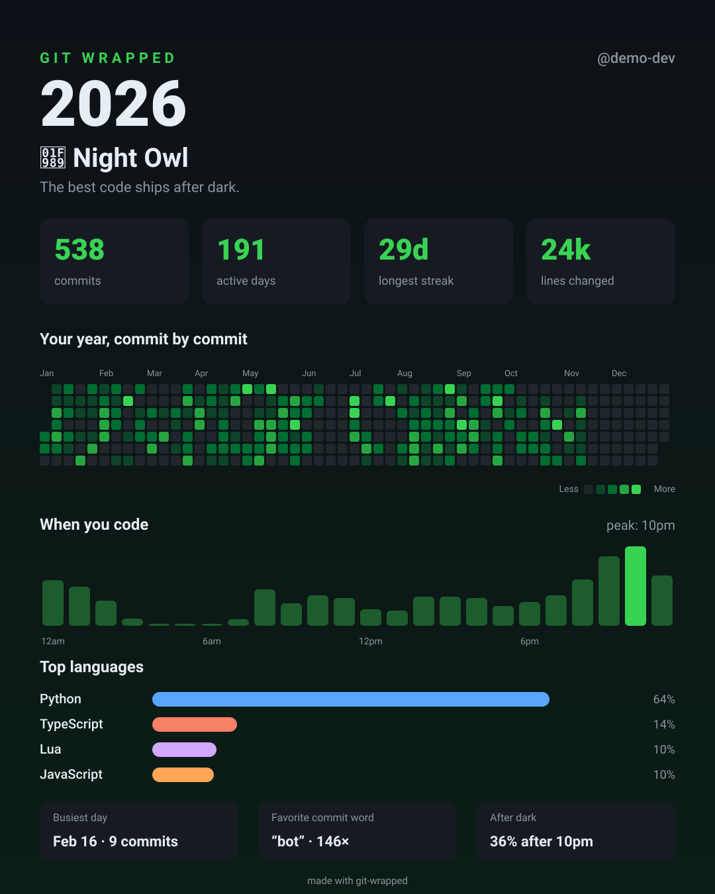

# 🎁 git-wrapped

> **Your year in git.** A Spotify-Wrapped-style summary of your commits: a colourful terminal report *and* a shareable SVG card. One command, 100% local, zero dependencies.

<p align="center">
  
</p>

## Features

- 🃏 **Shareable card**: a 1080×1350 SVG (or PNG with `--png`) with your contribution heatmap, hour-of-day chart, top languages and fun facts
- 🖥️ **Terminal report**: the same stats with a coloured heatmap, right in your shell
- 🦉 **A persona for your year**: Night Owl, Early Bird, Weekend Warrior, Streak Machine…
- 📦 **Many repos at once**: point it at `~/projects` and it finds every repo (commits are de-duplicated)
- 🔒 **Private by design**: it only runs `git log` locally. No network, no tokens, no accounts
- 🪶 **Zero dependencies**: pure Python standard library (3.9+)

## Install

```bash
pipx install git+https://github.com/Mohammadsdq/git-wrapped
# or, from a clone:
pip install .
```

## Usage

```bash
# current repo, this year (your git identity is used automatically)
git-wrapped

# every repo under a folder, for a specific year
git-wrapped ~/projects --year 2025

# put your handle on the card
git-wrapped ~/projects --name "@yourname" -o my-wrapped.svg

# count a teammate (or several identities of yours)
git-wrapped -a alice@example.com -a "Alice Smith"

# also export a PNG, ready to post
git-wrapped ~/projects --png

# PNG only
git-wrapped ~/projects -o my-wrapped.png

# machine-readable stats
git-wrapped --json
```

Open the generated `git-wrapped-<year>.svg` in any browser, or add `--png` to get an image you can post straight away.

**PNG export** has no Python dependency: git-wrapped uses whichever renderer it finds on your machine, in this order: Chrome/Chromium (best emoji rendering), `rsvg-convert`, `cairosvg`, Inkscape, ImageMagick. If none is installed the SVG is still saved and you get a hint about what to install.

> Tip: put `git-wrapped` on your `PATH` and git will let you call it as **`git wrapped`**.

### Options

| Flag | Description |
| --- | --- |
| `path` | A git repo, or a folder containing repos (default: `.`) |
| `-y, --year` | Year to summarise (default: current year) |
| `-a, --author` | Author name or email to count; repeatable. Default: your `git config` identity |
| `--all-authors` | Count commits from everyone |
| `-o, --output` | Output path: `*.svg`, or `*.png` for a PNG only (default: `git-wrapped-<year>.svg`) |
| `--png` | Also export a PNG next to the SVG |
| `--name` | Name or `@handle` printed on the card |
| `--no-svg` | Only print the terminal report (write no files) |
| `--json` | Print raw stats as JSON |
| `--no-color` | Disable ANSI colours (also honours `NO_COLOR`) |
| `--depth` | How deep to search for repos inside a folder (default: 3) |

## Personas

| Persona | When you get it |
| --- | --- |
| 🌱 Fresh Starter | fewer than 10 commits |
| 🦉 Night Owl | ≥ 35% of commits between 10pm and 5am |
| 🐦 Early Bird | ≥ 30% of commits between 5am and 9am |
| ⚔️ Weekend Warrior | ≥ 40% of commits on Saturday/Sunday |
| 🔥 Streak Machine | a streak of 14+ days in a row |
| ⚙️ Daily Grinder | active on 150+ days |
| 🧱 Steady Builder | everyone else |

Lock files, `node_modules`, `dist/` and minified files are ignored so one `npm install` doesn't make you "a JSON developer".

## Development

```bash
git clone https://github.com/Mohammadsdq/git-wrapped && cd git-wrapped
python -m unittest          # run the tests
python -m git_wrapped .     # run from source
```

## Ideas / good first issues

- [ ] Light theme and more colour themes
- [ ] Configurable weekend days (Fri/Sat, Thu/Fri…)
- [ ] RTL / Persian version of the card
- [ ] More personas and fun facts
- [ ] Compare two years side by side

PRs are very welcome!

## License

MIT

---

## 🇮🇷 فارسی

**git-wrapped** مثل «Spotify Wrapped» ولی برای کامیت‌های تو. با یک دستور، یک گزارش رنگی توی ترمینال و یک کارت SVG قابل‌اشتراک از سال کاری‌ات می‌گیری: نقشه‌ی گرمایی کامیت‌ها، ساعت‌های کدنویسی، زبان‌های پرکاربرد، طولانی‌ترین استریک، و یک «شخصیت» (جغد شب‌زنده‌دار، سحرخیز، جنگجوی آخر هفته و …).

- ۱۰۰٪ لوکال: فقط `git log` اجرا می‌شه، هیچ داده‌ای از سیستمت بیرون نمی‌ره
- بدون وابستگی: فقط پایتون ۳.۹ به بالا و git
- چند ریپو همزمان: پوشه‌ی پروژه‌هات رو بده تا خودش همه‌ی ریپوها رو پیدا کنه

```bash
pipx install git+https://github.com/Mohammadsdq/git-wrapped
git-wrapped ~/projects --year 2026 --name "@yourname"
```

بعد فایل `git-wrapped-2026.svg` رو توی مرورگر باز کن و به اشتراک بذار. با گزینه‌ی `--png` هم مستقیم یه عکس PNG آماده‌ی پست کردن می‌گیری (به Chrome یا یکی از رندرکننده‌های SVG نیاز داره). ⭐
